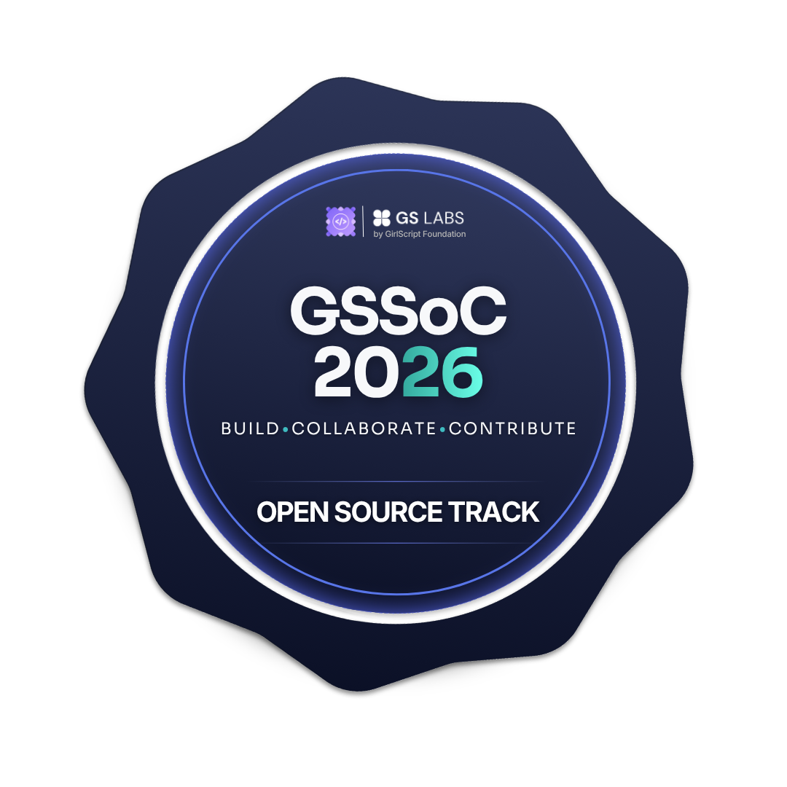

<div align="center">

<a href="https://github.com/neelabhshukla018">
  
</a>

<br/>


</div>

---

<h2 align="center">𝔾𝕊𝕊𝕠ℂ'𝟚𝟞 𝔸𝕔𝕙𝕚𝕖𝕧𝕞𝕖𝕟𝕥𝕤 </h2>  


<p align="center">

  <a href="https://gssoc.girlscript.org/profile/5188220f-4722-40d3-bc88-6f8492cff615">
    
  </a>

   <a href="https://gssoc.girlscript.org/profile/5188220f-4722-40d3-bc88-6f8492cff615">
    
  </a>

  <a href="https://gssoc.girlscript.org/profile/5188220f-4722-40d3-bc88-6f8492cff615">
    
  </a>

 

  <a href="https://gssoc.girlscript.org/profile/5188220f-4722-40d3-bc88-6f8492cff615">
    
  </a>
  

</p>

<p align="center">
  <b>𝙂𝙎𝙎𝙤𝘾 2026 𝘾𝙤𝙣𝙩𝙧𝙞𝙗𝙪𝙩𝙤𝙧</b> • <b>3,443 𝑷𝒐𝒊𝒏𝒕𝒔</b> • <b>𝙏𝙤𝙥 4%</b>
</p>


<br/>

<div align="center">

<table>
<tr>
<td align="center" valign="top" width="50%">

<svg xmlns="http://www.w3.org/2000/svg" width="20" height="75" viewBox="0 0 20 75">
  <path d="M10 0 V75" stroke="#C77B9B" stroke-width="2" stroke-dasharray="4 3"/>
  <circle cx="10" cy="10" r="5" fill="#C77B9B"/>
</svg>

<br/>


**𝑺𝒎𝒂𝒓𝒕𝒍𝒚 𝑳𝒂𝒃𝒔 𝑪𝒆𝒓𝒕𝒊𝒇𝒊𝒄𝒂𝒕𝒆**

</td>
<td align="center" valign="top" width="50%">

<svg xmlns="http://www.w3.org/2000/svg" width="20" height="75" viewBox="0 0 20 75">
  <path d="M10 0 V75" stroke="#C77B9B" stroke-width="2" stroke-dasharray="4 3"/>
  <circle cx="10" cy="10" r="5" fill="#C77B9B"/>
</svg>

<br/>


**𝑮𝑺𝑺𝒐𝑪 2026 𝑪𝒆𝒓𝒕𝒊𝒇𝒊𝒄𝒂𝒕𝒆**

</td>
</tr>
</table>

</div>

<br/>


#  𝔸𝕓𝕠𝕦𝕥 𝕄𝕖

<div align="center">

<table>
<tr>
<!-- LEFT CARD: DEVELOPER PROFILE -->
<td width="50%" valign="middle">

### `> 𝙙𝙚𝙫𝙚𝙡𝙤𝙥𝙚𝙧.𝙘𝙤𝙣𝙛𝙞𝙜`

```yaml
𝒏𝒂𝒎𝒆: 𝑵𝒆𝒆𝒍𝒂𝒃𝒉 𝑺𝒉𝒖𝒌𝒍𝒂
𝒕𝒊𝒕𝒍𝒆: 𝑭𝒖𝒍𝒍-𝑺𝒕𝒂𝒄𝒌 𝑫𝒆𝒗𝒆𝒍𝒐𝒑𝒆𝒓
𝒇𝒐𝒄𝒖𝒔: 𝑩𝒖𝒊𝒍𝒅𝒊𝒏𝒈 𝑺𝒄𝒂𝒍𝒂𝒃𝒍𝒆 𝑾𝒆𝒃 𝑨𝒑𝒑𝒍𝒊𝒄𝒂𝒕𝒊𝒐𝒏𝒔

𝕖𝕩𝕡𝕖𝕣𝕥𝕚𝕤𝕖:
  𝒇𝒓𝒐𝒏𝒕𝒆𝒏𝒅: 𝑹𝒆𝒂𝒄𝒕, 𝑵𝒆𝒙𝒕.𝒋𝒔, 𝑻𝒂𝒊𝒍𝒘𝒊𝒏𝒅 𝑪𝑺𝑺
  𝒃𝒂𝒄𝒌𝒆𝒏𝒅: 𝑵𝒐𝒅𝒆.𝒋𝒔, 𝑬𝒙𝒑𝒓𝒆𝒔𝒔.𝒋𝒔, 𝑹𝑬𝑺𝑻 𝑨𝑷𝑰𝒔
  𝒅𝒂𝒕𝒂𝒃𝒂𝒔𝒆𝒔: 𝑴𝒐𝒏𝒈𝒐𝑫𝑩, 𝑷𝒐𝒔𝒕𝒈𝒓𝒆𝑺𝑸𝑳, 𝑴𝒚𝑺𝑸𝑳

𝕖𝕩𝕡𝕝𝕠𝕣𝕚𝕟𝕘:
  - 𝑨𝒈𝒆𝒏𝒕𝒊𝒄 𝑨𝑰 & 𝑳𝑳𝑴 𝑨𝒑𝒑𝒍𝒊𝒄𝒂𝒕𝒊𝒐𝒏𝒔
  - 𝑨𝒅𝒗𝒂𝒏𝒄𝒆𝒅 𝑭𝒖𝒍𝒍-𝑺𝒕𝒂𝒄𝒌 𝑬𝒏𝒈𝒊𝒏𝒆𝒆𝒓𝒊𝒏𝒈
  - 𝑺𝒚𝒔𝒕𝒆𝒎 𝑫𝒆𝒔𝒊𝒈𝒏 (𝑳𝑳𝑫 & 𝑯𝑳𝑫)
  - 𝑫𝒆𝒗𝑶𝒑𝒔 & 𝑪𝒍𝒐𝒖𝒅 𝑰𝒏𝒇𝒓𝒂𝒔𝒕𝒓𝒖𝒄𝒕𝒖𝒓𝒆
  - 𝑫𝒂𝒕𝒂 𝑺𝒕𝒓𝒖𝒄𝒕𝒖𝒓𝒆𝒔 & 𝑨𝒍𝒈𝒐𝒓𝒊𝒕𝒉𝒎𝒔 𝒊𝒏 𝑱𝒂𝒗𝒂

𝕖𝕕𝕦𝕔𝕒𝕥𝕚𝕠𝕟:
  𝒅𝒆𝒈𝒓𝒆𝒆: 𝑩.𝑻𝒆𝒄𝒉 𝑪𝒐𝒎𝒑𝒖𝒕𝒆𝒓 𝑺𝒄𝒊𝒆𝒏𝒄𝒆 & 𝑬𝒏𝒈𝒊𝒏𝒆𝒆𝒓𝒊𝒏𝒈
  𝒚𝒆𝒂𝒓: 𝑪𝒖𝒓𝒓𝒆𝒏𝒕𝒍𝒚 𝑰𝒏 3𝒓𝒅 𝒀𝒆𝒂𝒓
  𝒖𝒏𝒊𝒗𝒆𝒓𝒔𝒊𝒕𝒚: 𝑺𝒉𝒓𝒊 𝑹𝒂𝒎𝒔𝒘𝒂𝒓𝒐𝒐𝒑 𝑴𝒆𝒎𝒐𝒓𝒊𝒂𝒍 𝑼𝒏𝒊𝒗𝒆𝒓𝒔𝒊𝒕𝒚

𝙢𝙞𝙣𝙙𝙨𝙚𝙩: 𝘽𝙪𝙞𝙡𝙙. 𝙎𝙤𝙡𝙫𝙚. 𝙄𝙣𝙣𝙤𝙫𝙖𝙩𝙚.
```

</td>

<!-- RIGHT CARD: HACKER ANIMATION -->
<td width="45%" valign="middle" align="center">

### `> 𝙨𝙮𝙨𝙩𝙚𝙢.𝙤𝙣𝙡𝙞𝙣𝙚`


**`01000010 01010101 01001001 01001100 01000100`**

`𝑨𝑪𝑪𝑬𝑺𝑺 𝑮𝑹𝑨𝑵𝑻𝑬𝑫 ✓`

</td>
</tr>
</table>

</div>

---


#  𝕋𝕖𝕔𝕙 𝕊𝕥𝕒𝕔𝕜

<div align="center">

<table>
<tr>
<td align="center" width="50%">

##  𝑳𝒂𝒏𝒈𝒖𝒂𝒈𝒆𝒔


</td>
<td align="center" width="50%">

## 𝑭𝒓𝒐𝒏𝒕𝒆𝒏𝒅


</td>
</tr>

<tr>
<td align="center" width="50%">

##  𝑩𝒂𝒄𝒌𝒆𝒏𝒅


<br/>


</td>
<td align="center" width="50%">

##  𝑫𝒂𝒕𝒂𝒃𝒂𝒔𝒆 & 𝑶𝑹𝑴


<br/>


</td>
</tr>

<tr>
<td align="center" width="50%">

##  𝑫𝒆𝒑𝒍𝒐𝒚𝒎𝒆𝒏𝒕 & 𝑪𝒍𝒐𝒖𝒅


<br/>


</td>
<td align="center" width="50%">

##  𝑻𝒐𝒐𝒍𝒔


</td>
</tr>
</table>

**━━━━━━━━━━ ✦ ━━━━━━━━━━**

`𝘽𝙐𝙄𝙇𝘿` • `𝙇𝙀𝘼𝙍𝙉` • `INNOVATE`

</div>


---

# 𝔽𝕖𝕒𝕥𝕦𝕣𝕖𝕕 ℙ𝕣𝕠𝕛𝕖𝕔𝕥𝕤

<div align="center">

<table>
<tr>

<td width="58%" valign="middle" align="center">

𝑨 𝒎𝒐𝒅𝒆𝒓𝒏 𝒃𝒍𝒐𝒈𝒈𝒊𝒏𝒈 𝒑𝒍𝒂𝒕𝒇𝒐𝒓𝒎 𝒄𝒐𝒎𝒃𝒊𝒏𝒊𝒏𝒈 𝑨𝑰-𝒑𝒐𝒘𝒆𝒓𝒆𝒅 𝒄𝒐𝒏𝒕𝒆𝒏𝒕 𝒄𝒓𝒆𝒂𝒕𝒊𝒐𝒏, 𝒑𝒖𝒃𝒍𝒊𝒔𝒉𝒊𝒏𝒈, 𝒂𝒏𝒅 𝒎𝒆𝒅𝒊𝒂 𝒎𝒂𝒏𝒂𝒈𝒆𝒎𝒆𝒏𝒕 𝒊𝒏 𝒐𝒏𝒆 𝒑𝒍𝒂𝒄𝒆.


<p align="center">
  
</p>

<br/>

<a href="https://despire-blogsmt.netlify.app/">

</a>
&nbsp;
<a href="https://github.com/neelabhshukla018/Despiree-_Blogs">

</a>

</td>


<td width="42%" valign="middle" align="center">
<h3>𝑫𝑬𝑺𝑷𝑰𝑹𝑬 — 𝑨𝑰 𝑩𝒍𝒐𝒈𝒈𝒊𝒏𝒈 𝑷𝒍𝒂𝒕𝒇𝒐𝒓𝒎</h3>
<a href="https://despire-blogsmt.netlify.app/">

</a>

</td>
</tr>
</table>

</div>

---


---


# ℂ𝕦𝕣𝕣𝕖𝕟𝕥𝕝𝕪 𝕃𝕖𝕒𝕣𝕟𝕚𝕟𝕘

<div align="center">

<table>
<tr>
<td align="center" width="50%">

### 🕸️ Agentic AI

`AI Agents` · `LLM Applications`

`AI Workflows` · `Tool Calling`

</td>
<td align="center" width="50%">

### 🕷️Advanced Full-Stack 


`Frontend & Backend` · `REST APIs`

`Authentication` · `System Integration`


</td>
</tr>
<tr>
<td align="center" width="50%">

### ⚙️ DevOps & Cloud

`Docker` · `CI/CD`

`AWS` · `Cloud Deployment`

</td>
<td align="center" width="50%">

### 🏗️ System Design

`LLD` · `HLD`

`Design Patterns` · `Scalability`

</td>
</tr>
<tr>
<td align="center" width="50%" colspan="2">


</td>
</tr>
</table>

</div>


# 𝕃𝕖𝕖𝕥ℂ𝕠𝕕𝕖

<div align="center">

<a href="https://leetcode.com/u/sirneelabhshuklaji/">
  
</a>

<a href="https://leetcode.com/u/sirneelabhshuklaji/">
  
</a>

</div>

---


# 𝔾𝕚𝕥ℍ𝕦𝕓 𝕊𝕥𝕒𝕥𝕤 𝕎𝕚𝕥𝕙 𝕄𝕖

<table>
<tr>
<td width="75%" align="center" valign="middle">

<a href="https://github.com/neelabhshukla018">
  
</a>

</td>
<td width="75%" align="center" valign="middle">

##  𝘾𝙤𝙣𝙣𝙚𝙘𝙩 𝙒𝙞𝙩𝙝 𝙈𝙚

<table>
<tr>
<td align="center">
<a href="https://github.com/neelabhshukla018">

</a>
</td>
<td align="center">
<a href="https://linkedin.com/in/neelabh-shukla-45b88a2a5">

</a>
</td>
</tr>
<tr>
<td align="center">
<a href="https://neel-xdev-ipu2.vercel.app/">

</a>
</td>
<td align="center">
<a href="https://www.instagram.com/satyam_shukla_1845/">

</a>
</td>
</tr>
</table>

</td>
</tr>
</table>

---


<div align="center">

### *"𝙄𝙛 𝙩𝙝𝙚𝙧𝙚 𝙞𝙨 1% 𝘾𝙝𝙖𝙣𝙘𝙚 𝙎𝙤𝙢𝙚𝙩𝙞𝙢𝙚𝙨 𝙩𝙝𝙖𝙩 𝙘𝙝𝙖𝙣𝙘𝙚 𝙞𝙨 𝙜𝙤𝙤𝙙 𝙚𝙣𝙤𝙪𝙜𝙝𝙩 𝙩𝙤 𝙖𝙘𝙝𝙚𝙞𝙫𝙚""*

<br/>


<div align="center">


<div align="center">


### ⭐ 𝕿𝖍𝖆𝖓𝖐𝖘 𝖋𝖔𝖗 𝖛𝖎𝖘𝖎𝖙𝖎𝖓𝖌 𝖒𝖞 𝖕𝖗𝖔𝖋𝖎𝖑𝖊!

</div>

</div>


