<div align="center">



<br/>

<a href="https://github.com/neelabhshukla018">
  
</a>
<a href="https://github.com/neelabhshukla018?tab=repositories">
  
</a>
<a href="https://komarev.com/ghpvc/?username=neelabhshukla018">
  
</a>

### `Full-Stack Developer` · `Agentic AI Learner` · `Problem Solver`

<a href="https://neel-xdev-ipu2.vercel.app/">Portfolio</a> •
<a href="https://linkedin.com/in/neelabh-shukla-45b88a2a5">LinkedIn</a> •
<a href="https://leetcode.com/u/sirneelabhshuklaji/">LeetCode</a>

</div>

---

## About Me

Hey! I'm **Neelabh Shukla**, a third-year B.Tech Computer Science & Engineering student at **Shri Ramswaroop Memorial University**.

I'm passionate about building modern web applications, exploring AI-powered solutions, and improving my problem-solving skills.

- Full-Stack Developer focused on building useful web products.
- Currently learning **Agentic AI, AI agents, and LLM applications**.
- Practising **Data Structures & Algorithms**.
- Exploring scalable backend systems, databases, and cloud technologies.
- Contributing to open source and learning by building real projects.

```js
const neelabh = {
  role: ["Full-Stack Developer", "Agentic AI Learner"],
  education: "B.Tech CSE — 3rd Year",
  university: "Shri Ramswaroop Memorial University",

  currentlyLearning: [
    "Agentic AI",
    "Data Structures & Algorithms",
    "System Design"
  ],

  languages: ["Java", "JavaScript", "TypeScript", "C", "C++"],

  frontend: ["React", "Next.js", "Tailwind CSS"],

  backend: ["Node.js", "Express.js", "REST APIs"],

  databases: ["MongoDB", "PostgreSQL", "MySQL"],

  goal: "Build useful products and keep learning."
};
```

---

## GSSoC 2026 Achievements

<div align="center">

<a href="https://gssoc.girlscript.org/profile/5188220f-4722-40d3-bc88-6f8492cff615">
  
</a>
<a href="https://gssoc.girlscript.org/profile/5188220f-4722-40d3-bc88-6f8492cff615">
  
</a>
<a href="https://gssoc.girlscript.org/profile/5188220f-4722-40d3-bc88-6f8492cff615">
  
</a>

### GSSoC 2026 Contributor

**3,443 Points · Top 4%**

<a href="https://gssoc.girlscript.org/profile/5188220f-4722-40d3-bc88-6f8492cff615">
  View My GSSoC Profile →
</a>

<br/><br/>

<table>
  <tr>
    <td align="center">
      
      <sub>Smartly Labs Certificate</sub>
    </td>
    <td align="center">
      
      <sub>GSSoC 2026 Certificate</sub>
    </td>
  </tr>
</table>

</div>

---

## Featured Projects

<div align="center">

<table>
  <tr>
    <td width="50%" valign="top">
      <h3>naXity</h3>
      <p>An AI-powered urban mobility and smart-city platform concept bringing navigation, mobility, discovery, weather intelligence, and emergency services together.</p>
      <p><strong>Technologies</strong></p>
      <p>Next.js · TypeScript · Tailwind CSS · Node.js · PostgreSQL · PostGIS · MapLibre</p>
    </td>
    <td width="50%" valign="top">
      <h3>DESPIRE</h3>
      <p>An AI-assisted blogging platform designed to support content creation and publishing through a modern web experience.</p>
      <p><strong>Technologies</strong></p>
      <p>React · Tailwind CSS · Node.js · Express.js · MongoDB · Cloudinary</p>
    </td>
  </tr>
  <tr>
    <td width="50%" valign="top">
      <h3>musX</h3>
      <p>A music-player application concept with a neumorphic interface, responsive design, and a focus on AI-powered song recommendations.</p>
      <p><strong>Technologies</strong></p>
      <p>Next.js · React · Tailwind CSS</p>
    </td>
    <td width="50%" valign="top">
      <h3>More Projects</h3>
      <p>Explore my repositories for additional projects, experiments, and development work.</p>
      <a href="https://github.com/neelabhshukla018?tab=repositories">Browse All Repositories →</a>
    </td>
  </tr>
</table>

</div>

---

## Tech Stack

### Languages

<p>
  
</p>

### Frontend Development

<p>
  
</p>

### Backend Development

<p>
  
  
  
  
  
</p>

### Databases & ORM

<p>
  
  
</p>

### Cloud, Deployment & Tools

<p>
  
  
</p>

---

## GitHub Statistics

<div align="center">


</div>

## GitHub Contribution Graph

<div align="center">


</div>

---

## LeetCode

<div align="center">

<a href="https://leetcode.com/u/sirneelabhshuklaji/">
  
</a>

<br/>

<a href="https://leetcode.com/u/sirneelabhshuklaji/">
  Visit My LeetCode Profile →
</a>

</div>

---

## Currently Learning

<div align="center">

| 🤖 Agentic AI | 🧠 DSA |
|:---:|:---:|
| AI Agents | Data Structures |
| AI Workflows | Algorithms |
| LLM Applications | Problem Solving |

| ⚡ Full-Stack Development | ☁️ Cloud & Systems |
|:---:|:---:|
| Advanced Next.js | Deployment |
| Backend Architecture | Scalable Systems |
| Full-Stack Applications | Cloud Services |

</div>

---

## What I'm Working Towards

- Building AI-powered applications.
- Improving DSA and problem-solving skills.
- Designing scalable full-stack systems.
- Creating useful, real-world products.
- Learning modern cloud technologies.
- Contributing to open source.
- Exploring Agentic AI and LLM-powered workflows.

---

## Connect With Me

<div align="center">

<a href="https://github.com/neelabhshukla018">
  
</a>
<a href="https://linkedin.com/in/neelabh-shukla-45b88a2a5">
  
</a>
<a href="https://neel-xdev-ipu2.vercel.app/">
  
</a>
<a href="https://leetcode.com/u/sirneelabhshuklaji/">
  
</a>
<a href="https://www.instagram.com/arjun_dream_1845/">
  
</a>

</div>

---

<div align="center">


### Thanks for visiting my profile!

**Build. Learn. Break. Improve. Repeat.**

</div>
