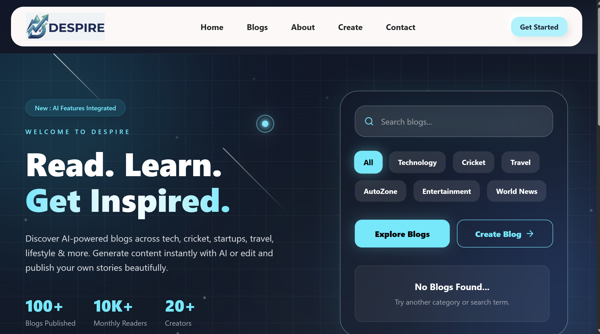

<div align="center">

<a href="https://github.com/neelabhshukla018">
  
</a>

<br/>


</div>


---

<h2 align="center">🏆 GSSoC-2026 Achievements</h2>

<p align="center">

  <a href="https://gssoc.girlscript.org/profile/5188220f-4722-40d3-bc88-6f8492cff615">
    
  </a>

  <a href="https://gssoc.girlscript.org/profile/5188220f-4722-40d3-bc88-6f8492cff615">
    
  </a>

  <a href="https://gssoc.girlscript.org/profile/5188220f-4722-40d3-bc88-6f8492cff615">
    
  </a>

</p>

<p align="center">
  <b>GSSoC 2026 Contributor</b> • <b>3,443 Points</b> • <b>Top 4%</b>
</p>


<br/>

<div align="center">

<table>
<tr>
<td align="center" valign="top" width="50%">

<svg xmlns="http://www.w3.org/2000/svg" width="20" height="75" viewBox="0 0 20 75">
  <path d="M10 0 V75" stroke="#C77B9B" stroke-width="2" stroke-dasharray="4 3"/>
  <circle cx="10" cy="10" r="5" fill="#C77B9B"/>
</svg>

<br/>


**Smartly Labs Certificate**

</td>
<td align="center" valign="top" width="50%">

<svg xmlns="http://www.w3.org/2000/svg" width="20" height="75" viewBox="0 0 20 75">
  <path d="M10 0 V75" stroke="#C77B9B" stroke-width="2" stroke-dasharray="4 3"/>
  <circle cx="10" cy="10" r="5" fill="#C77B9B"/>
</svg>

<br/>


**GSSoC 2026 Certificate**

</td>
</tr>
</table>

</div>

<br/>


## 👨‍💻 About Me

<div align="center">

<table>
<tr>
<!-- LEFT CARD: DEVELOPER PROFILE -->
<td width="50%" valign="middle">

### `> developer.config`

```yaml
name: Neelabh Shukla
title: Full-Stack Developer
focus: Building Scalable Web Applications

expertise:
  frontend: React, Next.js, Tailwind CSS
  backend: Node.js, Express.js, REST APIs
  databases: MongoDB, PostgreSQL, MySQL

exploring:
  - Agentic AI & LLM Applications
  - Advanced Full-Stack Engineering
  - System Design (LLD & HLD)
  - DevOps & Cloud Infrastructure
  - Data Structures & Algorithms in Java

education:
  degree: B.Tech Computer Science & Engineering
  year: Currently In 3rd Year
  university: Shri Ramswaroop Memorial University

mindset: Build. Solve. Innovate.
```

</td>

<!-- RIGHT CARD: HACKER ANIMATION -->
<td width="45%" valign="middle" align="center">

### `> system.online`


**`01000010 01010101 01001001 01001100 01000100`**

`ACCESS GRANTED ✓`

</td>
</tr>
</table>

</div>

---


# ⚡ Tech Stack

<div align="center">

<table>
<tr>
<td align="center" width="50%">

### 💻 Languages


</td>
<td align="center" width="50%">

### 🎨 Frontend


</td>
</tr>

<tr>
<td align="center" width="50%">

### ⚙️ Backend


<br/>


</td>
<td align="center" width="50%">

### 🗄️ Database & ORM


<br/>


</td>
</tr>

<tr>
<td align="center" width="50%">

### ☁️ Deployment & Cloud


<br/>


</td>
<td align="center" width="50%">

### 🛠️ Tools


</td>
</tr>
</table>

**━━━━━━━━━━ ✦ ━━━━━━━━━━**

`BUILD` • `LEARN` • `INNOVATE`

</div>


---

# 📊 GitHub Stats


<div align="center">


</div>

---


# 🚀 Featured Projects

<div align="center">

<table>
<tr>

<td width="58%" valign="middle" align="center">

A modern blogging platform combining AI-powered content creation, publishing, and media management in one place.


<p align="center">
  
</p>

<br/>

<a href="https://despire-blogsmt.netlify.app/">

</a>
&nbsp;
<a href="https://github.com/neelabhshukla018/Despiree-_Blogs">

</a>

</td>


<td width="42%" valign="middle" align="center">
<h3>DESPIRE — AI Blogging Platform</h3>
<a href="https://despire-blogsmt.netlify.app/">

</a>

</td>
</tr>
</table>

</div>

---


---


## 🎯 Currently Learning

<div align="center">

<table>
<tr>
<td align="center" width="50%">

### 🕸️ Agentic AI

`AI Agents` · `LLM Applications`

`AI Workflows` · `Tool Calling`

</td>
<td align="center" width="50%">

### 🕷️Advanced Full-Stack 


`Frontend & Backend` · `REST APIs`

`Authentication` · `System Integration`


</td>
</tr>
<tr>
<td align="center" width="50%">

### ⚙️ DevOps & Cloud

`Docker` · `CI/CD`

`AWS` · `Cloud Deployment`

</td>
<td align="center" width="50%">

### 🏗️ System Design

`LLD` · `HLD`

`Design Patterns` · `Scalability`

</td>
</tr>
<tr>
<td align="center" width="50%" colspan="2">


</td>
</tr>
</table>

</div>


## 🧠 LeetCode

<div align="center">

<a href="https://leetcode.com/u/sirneelabhshuklaji/">
  
</a>

<a href="https://leetcode.com/u/sirneelabhshuklaji/">
  
</a>

</div>

---

# 🌐 Connect With Me

<div align="center">

<a href="https://github.com/neelabhshukla018">

</a>

<a href="https://linkedin.com/in/neelabh-shukla-45b88a2a5">

</a>

<a href="https://neel-xdev-ipu2.vercel.app/">

</a>


<a href="https://www.instagram.com//satyam_shukla_1845/">

</a>

</div>

---

<div align="center">

### 💭 *"Build. Learn. Break. Improve. Repeat."*

<br/>


<div align="center">


### ⭐ Thanks for visiting my profile!

</div>

</div>


