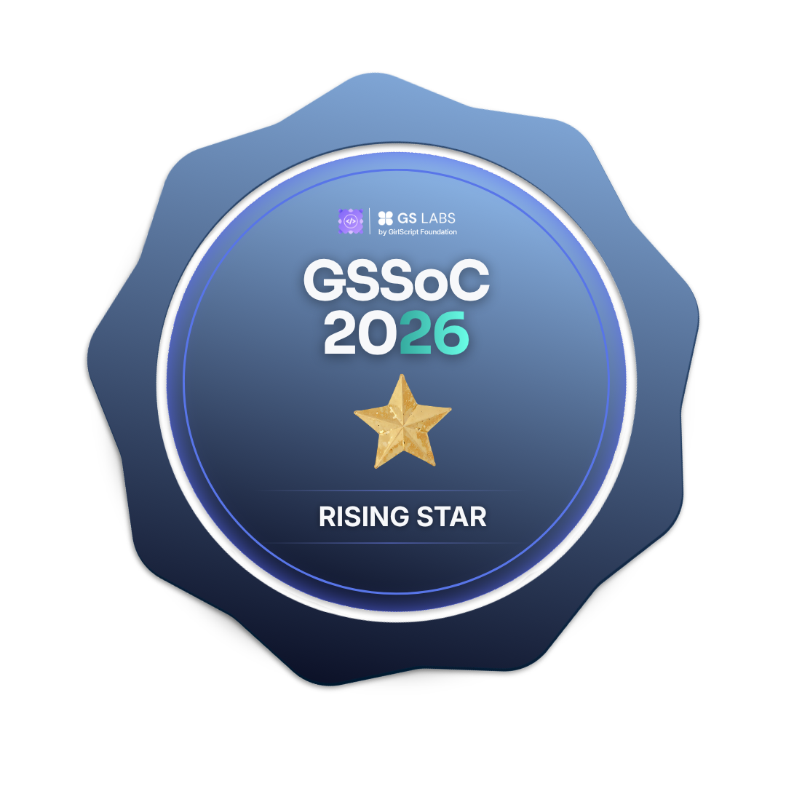
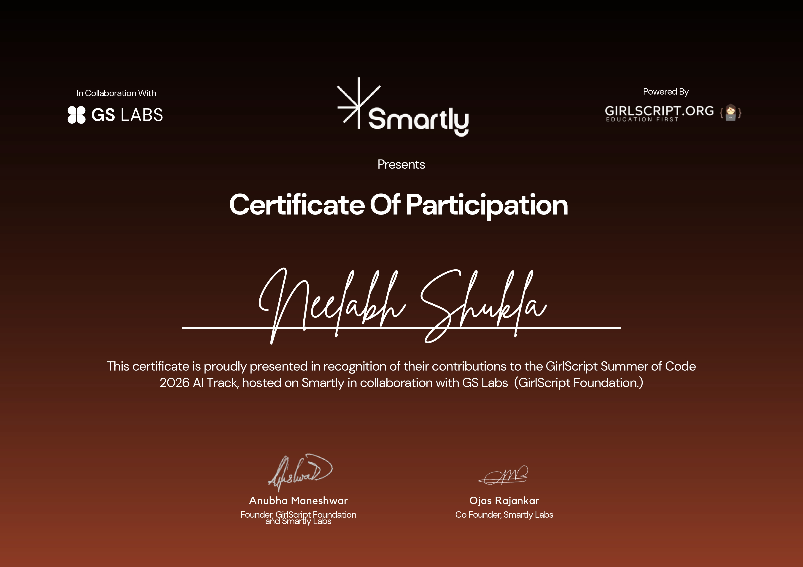
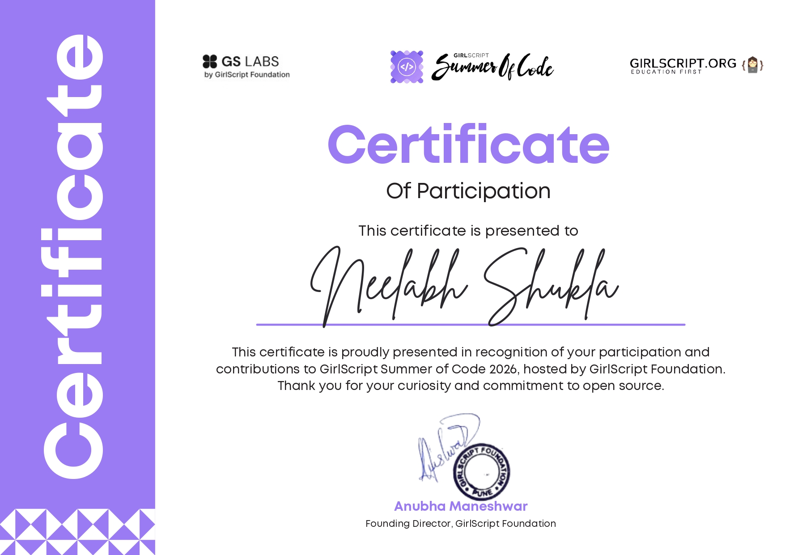

<div align="center">

# 👋 Hi, I'm **Neelabh Shukla**

### `Full-Stack Developer` • `Agentic AI Learner` • `Problem Solver`


<br/>


<a href="https://github.com/neelabhshukla018">

</a>

<a href="https://github.com/neelabhshukla018?tab=repositories">

</a>

</div>

---

<h2 align="center">🏆 GSSoC-2026 Achievements</h2>

<p align="center">

  <a href="https://gssoc.girlscript.org/profile/5188220f-4722-40d3-bc88-6f8492cff615">
    
  </a>

  <a href="https://gssoc.girlscript.org/profile/5188220f-4722-40d3-bc88-6f8492cff615">
    
  </a>

  <a href="https://gssoc.girlscript.org/profile/5188220f-4722-40d3-bc88-6f8492cff615">
    
  </a>

</p>

<p align="center">
  <b>GSSoC 2026 Contributor</b> • <b>3,443 Points</b> • <b>Top 4%</b>
</p>


<br/>

<div align="center">

<h2>🏆 My Certificates</h2>

<table>
<tr>
<td align="center" width="50%">
<pre>       │
       │
       ●
       │
       │</pre>

<strong>Smartly Labs Certificate</strong>
</td>

<td align="center" width="50%">
<pre>       │
       │
       ●
       │
       │</pre>

<strong>GSSoC 2026 Certificate</strong>
</td>
</tr>
</table>

</div>

<br/>

#  About Me

```js
const neelabh = {
    role: "Full-Stack Developer",
    education: "B.Tech CSE — 3rd Year",
    university: "Shri Ramswaroop Memorial University",
    currentlyLearning: ["Agentic AI", "DSA", "System Design"],
    languages: ["Java", "JavaScript", "TypeScript", "C", "C++"],
    frontend: ["React", "Next.js", "Tailwind CSS"],
    backend: ["Node.js", "Express.js", "REST APIs"],
    databases: ["MongoDB", "PostgreSQL", "MySQL"],
    goal: "Build useful products and keep learning "
};
```
---


# ⚡ Tech Stack

<div align="center">

<table>
<tr>
<td align="center" width="50%">

### 💻 Languages


</td>
<td align="center" width="50%">

### 🎨 Frontend


</td>
</tr>

<tr>
<td align="center" width="50%">

### ⚙️ Backend


<br/>


</td>
<td align="center" width="50%">

### 🗄️ Database & ORM


<br/>


</td>
</tr>

<tr>
<td align="center" width="50%">

### ☁️ Deployment & Cloud


<br/>


</td>
<td align="center" width="50%">

### 🛠️ Tools


</td>
</tr>
</table>

**━━━━━━━━━━ ✦ ━━━━━━━━━━**

`BUILD` • `LEARN` • `INNOVATE`

</div>


---

# 📊 GitHub Stats


<div align="center">


</div>

---

# 🟩 GitHub Contributions

<div align="center">


</div>

<br/>


---


# 🧠 LeetCode

<div align="center">


</div>

---

# 🎯 Currently Learning

<div align="center">

|   🤖 Agentic AI  |      🧠 DSA     |
| :--------------: | :-------------: |
|     AI Agents    | Data Structures |
|   AI Workflows   |    Algorithms   |
| LLM Applications | Problem Solving |

|        ⚡ Next.js        |     ☁️ Cloud     |
| :---------------------: | :--------------: |
|   Advanced App Router   |    Deployment    |
|   Backend Architecture  | Scalable Systems |
| Full-Stack Applications |  Cloud Services  |

</div>

---

# 🏆 What I'm Working Towards

* 🤖 Building AI-powered applications
* 🧠 Improving DSA and problem-solving skills
* 🏗️ Designing scalable full-stack systems
* 🌐 Building real-world products
* ☁️ Learning modern cloud technologies
* 🔓 Contributing more to open-source
* 🚀 Exploring the future of Agentic AI

---

# 🌐 Connect With Me

<div align="center">

<a href="https://github.com/neelabhshukla018">

</a>

<a href="https://linkedin.com/in/neelabh-shukla-45b88a2a5">

</a>

<a href="https://neel-xdev-ipu2.vercel.app/">

</a>

<a href="https://leetcode.com/u/sirneelabhshuklaji/">

</a>

<a href="https://www.instagram.com//satyam_shukla_1845/">

</a>

</div>

---

<div align="center">

### 💭 *"Build. Learn. Break. Improve. Repeat."*

<br/>


<br/><br/>

### ⭐ Thanks for visiting my profile!

</div>


